# Coding Usage Monitor for ESP32-TFT

**Know how much Claude and Codex you have left, at a glance, without opening a single tab.**

A tiny touchscreen on your desk shows your Claude and Codex subscription usage: how much of the 5-hour window and the weekly window is left, when each one resets, and how many Codex banked resets you still hold. A small server in your homelab does the fetching. A browser-based Admin app lets you tune everything from your phone.

<p align="center">
  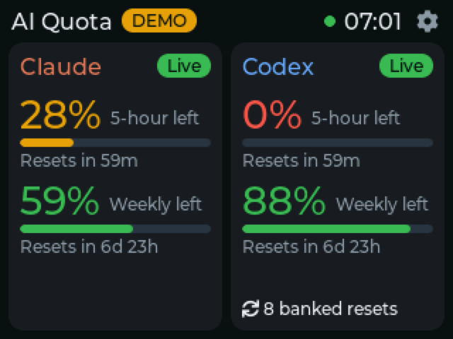
  &nbsp;
  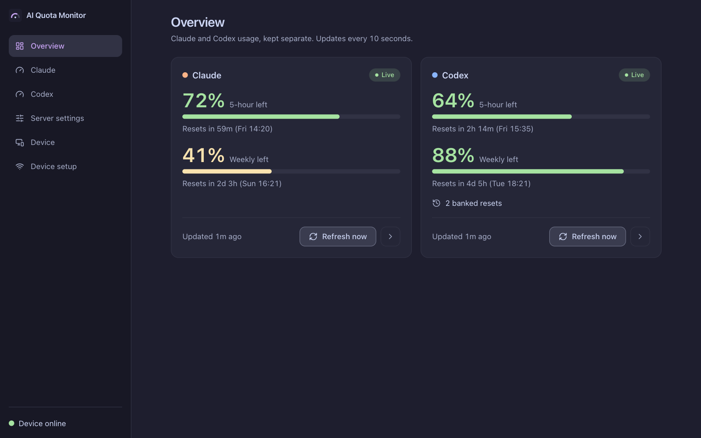
</p>
<p align="center"><sub>Screenshots use synthetic demo data from the built-in simulator and mock API.</sub></p>

## Why you will like it

- **One glance, both providers.** Claude and Codex sit side by side. Each shows the percentage left, a bar, and "Resets in 59m (Fri 08:00)".
- **It tells the truth.** An unreadable value is shown as unavailable, never as 0%. Old data is marked stale. When a window has reset but the provider has not refreshed yet, you see "Awaiting refresh", not a made-up 100%.
- **Codex banked resets.** See how many you hold and when each one expires, so you use them before they vanish.
- **Your data stays home.** Everything runs on your own machine. There is no cloud service, no account with us, and no analytics.
- **Tokens never touch the screen device.** Login happens on the server. The ESP32 only receives finished percentages over your LAN.
- **Setup you can do on a phone.** The device creates its own Wi-Fi hotspot with a short 8-digit password. The MQTT password is 12 digits, so it fits on a phone number pad. The Admin app has copy buttons for every value you need to type.
- **Three looks, switch from the browser.** Cards, Gauges, or Terminal. Change brightness and timezone from the same page.
- **Rate-limit friendly.** Choose how often each provider is polled. A provider's `Retry-After` is always respected and never shortened.
- **Survives reboots and Wi-Fi changes.** The device remembers its settings. A *Reconfigure Wi-Fi* button on the screen starts setup again when you change router or move the server.

## Screenshots

### On the device (320×240 touchscreen)

| Cards | Gauges | Terminal |
|---|---|---|
|  | 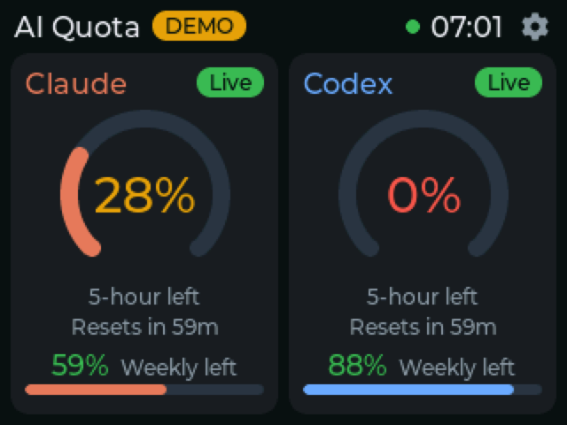 | 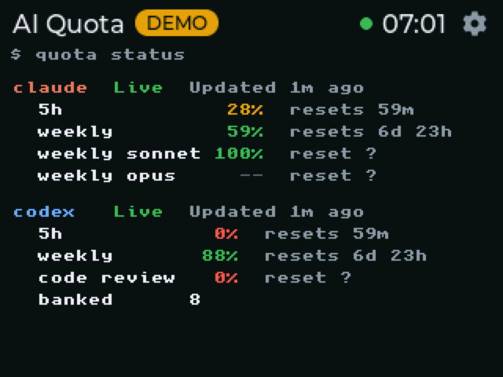 |

| Provider detail | Settings | Wi-Fi setup |
|---|---|---|
| 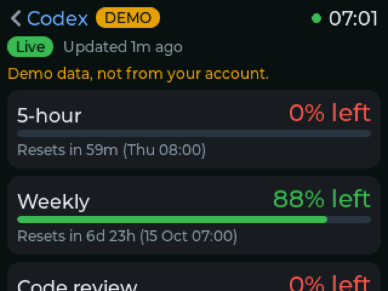 | 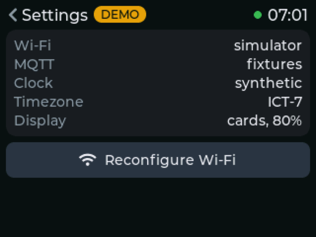 | 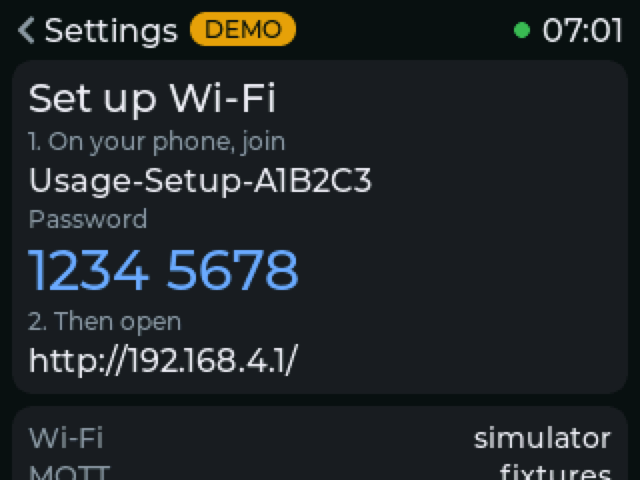 |

### In the Admin app (dark, Catppuccin Mocha, works on mobile)

| Codex detail | Device settings |
|---|---|
| 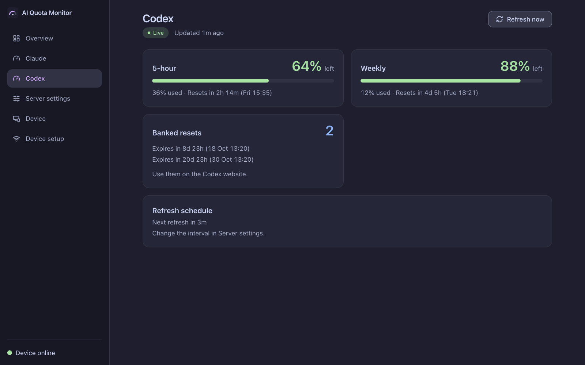 | 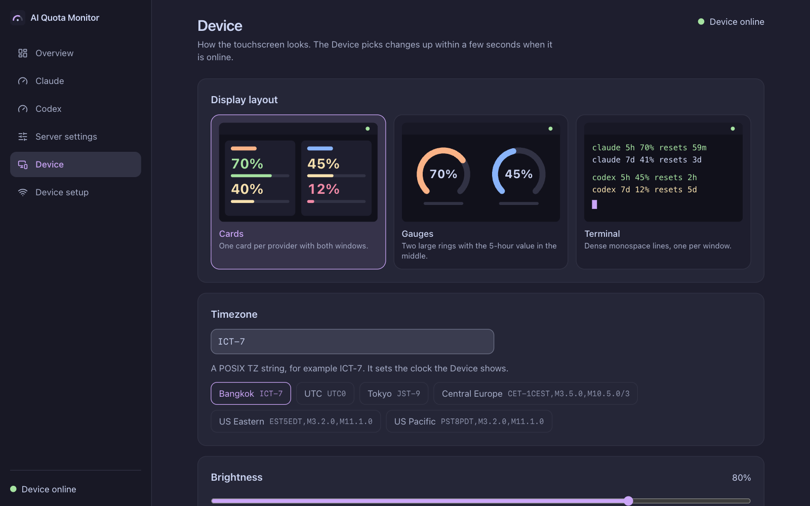 |

| Server settings | Device setup (copy buttons) | Mobile |
|---|---|---|
| 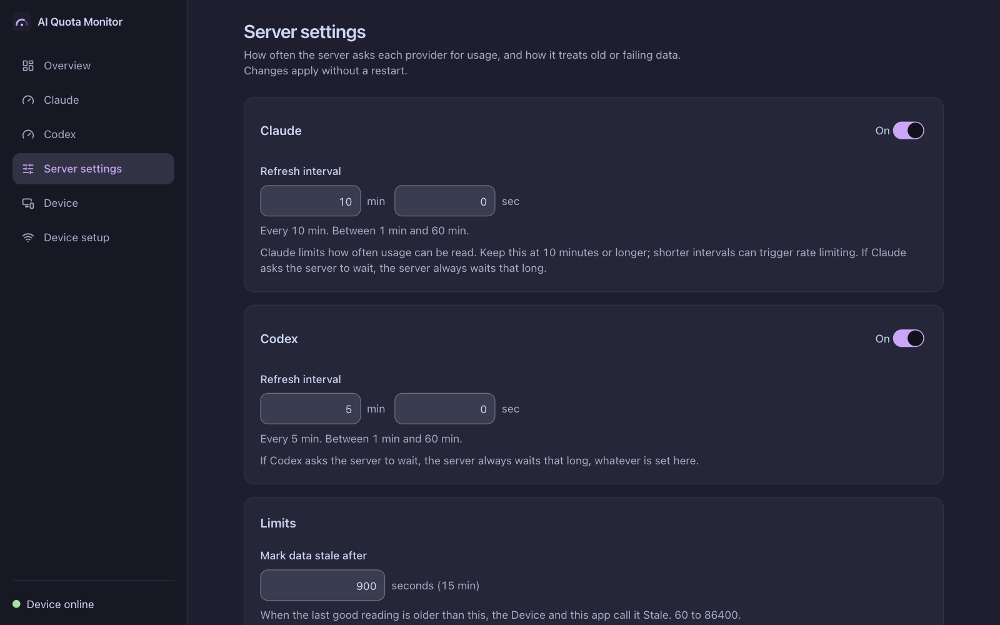 | 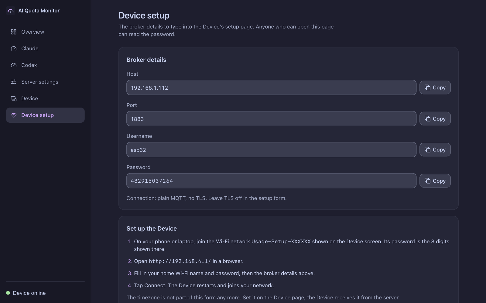 | 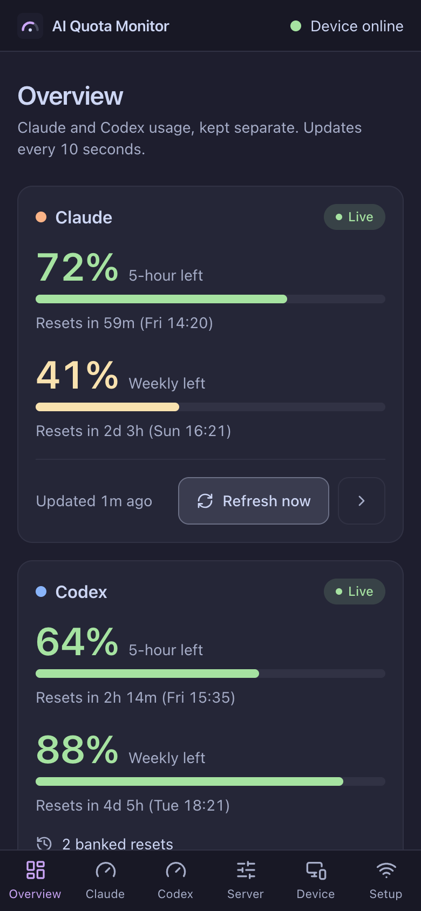 |

## How it works

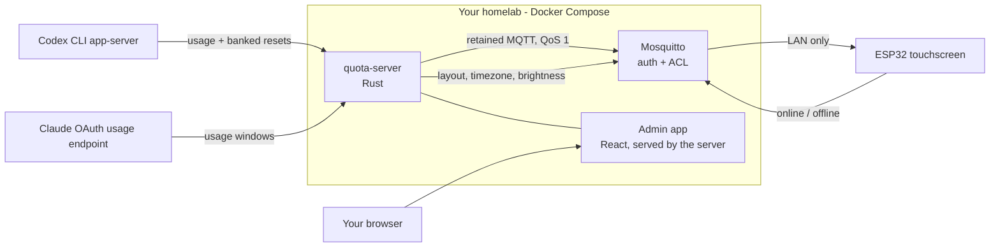

- **quota-server** (Rust) logs in to each provider with credentials stored only on the server, polls on the schedule you set, normalizes the answers, and publishes one JSON snapshot per provider.
- **Mosquitto** carries snapshots to the device. The device account can only read usage topics and write its own online status.
- **The device** (ESP-IDF + LVGL) renders the snapshots. It does its own countdown with NTP time, so it does not need a message every second.
- **The Admin app** is a static React app served by the same Rust server on one port. It reads the same snapshots and edits Server settings and Device settings.

## What you need

**Hardware**
- An **ESP32-2432S028** board (the "Cheap Yellow Display", 2.8" 320×240 ILI9341 touchscreen with XPT2046 touch, ESP32-WROOM-32, 4 MB flash). The firmware ships with that board's pin map. Other boards need pin changes in `firmware/main/Kconfig.projbuild`.
- A micro-USB cable.

**Server host** (a homelab box, mini PC, NAS or a spare laptop)
- Linux **`amd64`** (x86-64). The prebuilt images are `linux/amd64` only. On an `arm64` machine (Raspberry Pi, Apple Silicon without emulation) build from source by adding `--build` to the `up` commands; that needs Rust's build disk space.
- Docker Engine with Docker Compose v2, and Python 3.
- A fixed LAN IP for that machine (see [Give the server a stable IP](#give-the-server-a-stable-ip)).

**Your computer, only to flash the firmware once**
- [`esptool`](https://docs.espressif.com/projects/esptool/) (`pipx install esptool`) and a USB port. Docker is only needed if you choose to build the firmware yourself.

**Accounts**
- A Codex (ChatGPT) subscription and/or a Claude subscription. Either one works; you can use only one.

## Install, step by step

Replace `192.168.1.50` with your server's LAN IP throughout.

### 1. Get the code

```sh
git clone https://github.com/seenark/coding-usage-monitor-for-esp32tft.git
cd coding-usage-monitor-for-esp32tft
```

### 2. Create the server configuration

```sh
HOST_UID=$(id -u) HOST_GID=$(id -g) ./scripts/setup.sh
```

This creates `deploy/.env`, private state folders (mode `0700`) and two random MQTT passwords. It never prints a password. It is safe to run again.

Open `deploy/.env` and set the two addresses to your server's LAN IP:

```sh
MQTT_BIND_ADDRESS=192.168.1.50   # where the device will connect
ADMIN_BIND_ADDRESS=192.168.1.50  # where you open the Admin app
```

Use a real LAN address, never `0.0.0.0`. Then run `./scripts/setup.sh` once more so it validates your edit.

### 3. Try it with demo data first (optional, 2 minutes)

No logins needed. This proves Docker, the broker and the Admin app work:

```sh
docker compose --env-file deploy/.env -f deploy/compose.yaml --profile mock up -d mosquitto quota-server-mock
./scripts/subscriber.sh 3 30      # prints three JSON messages
```

Open `http://192.168.1.50:8080`. You will see demo numbers. Stop the demo before going live, because both publish to the same topics:

```sh
docker compose --env-file deploy/.env -f deploy/compose.yaml --profile mock stop quota-server-mock
```

### 4. Log in to your providers (on the server)

Login runs inside a helper container that stores credentials in `deploy/state/auth`. It never uses your Mac keychain and never copies credentials from another machine.

**Codex**

```sh
./scripts/auth.sh codex login     # follow the device-code instructions in your browser
./scripts/auth.sh codex status    # expect: Subscription authentication verified.
```

**Claude** (optional)

```sh
./scripts/auth.sh claude login    # open the URL, sign in, paste the code if asked
./scripts/auth.sh claude status
```

> **Read this before enabling Claude.** Claude has no official quota API for subscriptions. This project reads the same private OAuth usage endpoint that other community tools use. It is unofficial, can change or be blocked at any time, and you use it at your own risk. That is why it is **off by default**. If it is rejected, the Claude card shows an error and Codex keeps working.

### 5. Start the real server

```sh
docker compose --env-file deploy/.env -f deploy/compose.yaml --profile live up -d mosquitto quota-server
```

The first start downloads the prebuilt `quota-server` image (about 370 MB on disk, `linux/amd64`) from GitHub Container Registry. You do not need Rust or a compiler. To build from source instead, add `--build` (needs several GB of disk and some patience).

Open `http://192.168.1.50:8080`. To turn Claude on, go to **Server settings**, switch Claude on and save. No restart is needed.

Find the values you will type into the device:

```sh
docker compose --env-file deploy/.env -f deploy/compose.yaml logs quota-server | grep 'Device setup'
```

or open the **Device setup** page in the Admin app, which has a copy button for each value.

### 6. Flash the firmware

Connect the board over USB. Find its port (`ls /dev/cu.usb*` on macOS, `ls /dev/ttyUSB*` on Linux). Install [`esptool`](https://docs.espressif.com/projects/esptool/) once with `pipx install esptool`.

**Option A, prebuilt (recommended).** Download `quota-monitor-<version>-full.bin` and `SHA256SUMS` from the [latest release](https://github.com/seenark/coding-usage-monitor-for-esp32tft/releases/latest), then:

```sh
shasum -a 256 -c SHA256SUMS --ignore-missing
esptool --chip esp32 -p /dev/cu.usbserial-XXXX -b 460800 write-flash 0x0 quota-monitor-<version>-full.bin
```

The `-full.bin` image also blanks the settings area, so use it for a first install. To update a board that is already set up and keep its Wi-Fi and broker settings, flash `quota-monitor-<version>-app.bin` at `0x10000` instead:

```sh
esptool --chip esp32 -p /dev/cu.usbserial-XXXX -b 460800 write-flash 0x10000 quota-monitor-<version>-app.bin
```

**Option B, build it yourself.** Needs Docker and about 5 GB of disk:

```sh
docker run --rm -v "$PWD":/project -w /project/firmware -e HOME=/tmp espressif/idf:v5.3.3 bash -c \
  'idf.py -B /project/build/firmware-esp32 set-target esp32 && idf.py -B /project/build/firmware-esp32 build'
cd build/firmware-esp32
esptool --chip esp32 -p /dev/cu.usbserial-XXXX -b 460800 \
  --before default-reset --after hard-reset write-flash @flash_args
```

A successful flash ends with `Hash of data verified`, and the board reboots by itself. The firmware never prints secrets to serial, so a quiet serial console is normal.

### 7. Set up the device from your phone

The screen shows **Set up Wi-Fi** with a network named `Usage-Setup-XXXXXX` and an 8-digit password.

1. On your phone, join that Wi-Fi network using the 8 digits.
2. Open `http://192.168.4.1/`.
3. Fill in the form:
   - **Wi-Fi name and password:** your home 2.4 GHz network (the ESP32 has no 5 GHz radio).
   - **MQTT host:** `192.168.1.50`
   - **Port:** `1883`
   - **Username:** `esp32`
   - **Password:** the 12 digits from the Device setup page.
   - **TLS:** off (see [Security](#security-model)).
4. Tap **Connect**. The setup network disappears, the device joins your Wi-Fi and the screen switches to the overview within a few seconds.

If you mistype the Wi-Fi password, the device returns to the setup page and says so, then you simply try again. Your settings are saved only after the device has really joined Wi-Fi.

### 8. Make it yours

Open **Device** in the Admin app to pick Cards, Gauges or Terminal, set the timezone (for example `ICT-7`, `UTC0`, `JST-9`) and brightness. The device applies changes within seconds and remembers them across reboots.

## Deploy on your homelab

Do the same steps on the homelab machine. A few things deserve care.

### Give the server a stable IP

The device connects to a fixed address, so the server's IP must not change. In your router, add a **DHCP reservation** for the server's MAC address (for example `192.168.1.50`). A Tailscale IP will not work, because the ESP32 cannot join a tailnet.

If the IP ever changes, update `MQTT_BIND_ADDRESS` and `ADMIN_BIND_ADDRESS`, run `./scripts/setup.sh`, recreate the containers, and use **Settings → Reconfigure Wi-Fi** on the device to enter the new host.

### Log in on the homelab itself

Run the `auth.sh` logins on the homelab. Do not copy `auth.json` or `.credentials.json` from your laptop. Two machines sharing one refresh-token chain will log each other out.

### Firewall

Allow port `1883` only from your LAN. Never port-forward the broker. Keep Docker's published ports bound to the LAN address from `deploy/.env`.

### Reach the Admin app from outside (Cloudflare Tunnel)

The Admin app has **no login of its own**. It shows the device MQTT password and can change settings, so if you publish it, put **Cloudflare Access** (or another identity-aware proxy) in front of it first. Point the tunnel at `http://<server-ip>:8080`. Do not publish the app without an access policy. The MQTT password only works inside your LAN, but treat the page as sensitive. Details: [ADR 0003](docs/adr/0003-admin-app-protected-by-cloudflare-access-only.md).

### Start on boot, update, back up

The containers use `restart: unless-stopped`, so they come back after a reboot.

```sh
# Update to the newest published images
git pull
docker compose --env-file deploy/.env -f deploy/compose.yaml --profile live pull
docker compose --env-file deploy/.env -f deploy/compose.yaml --profile live up -d mosquitto quota-server

# Stop everything (state is kept)
docker compose --env-file deploy/.env -f deploy/compose.yaml --profile live --profile mock down
```

Back up `deploy/state/` (provider logins, broker data, saved settings) to encrypted storage. Treat it like a password store.

## Configuration

### Server settings (Admin app → Server settings)

| Setting | Default | Range |
|---|---|---|
| Claude refresh interval | 10 min | 60 s – 3600 s |
| Codex refresh interval | 5 min | 60 s – 3600 s |
| Provider on/off | Codex on, Claude off | |
| Stale after | 900 s | 60 – 86400 s |
| Max backoff | 1800 s | 60 – 86400 s, at least every interval |
| Request timeout | 12 s | 1 – 60 s |

Changes apply immediately. A shorter interval never overrides a provider's `Retry-After`, and **Refresh now** will not bypass a rate limit; it tells you how long to wait.

### Device settings (Admin app → Device)

Layout (`cards`, `gauges`, `terminal`), timezone (POSIX TZ string such as `ICT-7`), and brightness (10–100).

### Environment variables (`deploy/.env`)

These are the defaults. Values saved by the Admin app (`settings.json`) win over them.

| Variable | Purpose |
|---|---|
| `MQTT_BIND_ADDRESS`, `MQTT_HOST_PORT` | Where Mosquitto listens on the host |
| `ADMIN_BIND_ADDRESS`, `ADMIN_PORT` | Where the Admin app listens on the host |
| `CODEX_ENABLED`, `CLAUDE_PRIVATE_USAGE_ENABLED` | Default on/off per provider |
| `CODEX_POLL_INTERVAL_SECONDS`, `CLAUDE_POLL_INTERVAL_SECONDS` | Default refresh intervals |
| `STALE_AFTER_SECONDS`, `MAX_BACKOFF_SECONDS`, `REQUEST_TIMEOUT_SECONDS` | Timing limits |

After editing `deploy/.env`, use `up -d --force-recreate quota-server`. A plain `restart` does not reload it.

## Security model

| Topic | What this project does |
|---|---|
| Provider credentials | Stay on the server in `deploy/state/auth` (mode `0700`/`0600`). Never sent to MQTT or the device. |
| Container | Non-root user, read-only root filesystem, all capabilities dropped. |
| MQTT | Authentication required, no anonymous access, per-user ACL. The device can read usage topics and write only its own status. |
| Device storage | Wi-Fi and broker details are stored **unencrypted** in NVS. Someone holding the device can read them from flash. This is deliberate ([ADR 0002](docs/adr/0002-device-credentials-in-unencrypted-nvs.md)). |
| Transport | MQTT is plain TCP on your LAN by default. Anyone who can sniff your LAN could read it. The server supports TLS (`MQTT_TLS`, `MQTT_CA_FILE`) but this repo does not generate certificates. |
| Admin app | No login. Protect it with Cloudflare Access or keep it LAN-only. |
| Setup hotspot | WPA2 with a per-boot random 8-digit password that is shown only on the screen. |
| Quota actions | Read-only. The project never redeems a banked reset, buys anything, or runs model inference. |

## Troubleshooting

| Symptom | Likely cause and fix |
|---|---|
| Card says **Off** | The provider is disabled. Enable it in Server settings (Claude is off by default). |
| Card says **Sign in** | Login expired. Stop the server, run `./scripts/auth.sh <provider> login`, start it, press **Refresh now**. |
| Card says **Stale** | The server has not refreshed recently. Check `docker compose ... logs quota-server`. |
| **Rate limited** | The provider asked you to wait. Raise the refresh interval; the page shows the remaining wait. |
| Device cannot reach the broker | Wrong host, port or password, or Wi-Fi client isolation on your router. Check `nc -z 192.168.1.50 1883` from another LAN device. |
| Setup page shows "Cannot join Wi-Fi" | Open Settings (gear) → **Reconfigure Wi-Fi** and re-enter your details. |
| The setup page returns 403 | Open `http://192.168.4.1/` while connected to the `Usage-Setup-…` network only. |
| Permission denied in containers | `HOST_UID` / `HOST_GID` in `deploy/.env` must own `deploy/state`. Never use `chmod 777`. |
| Device online dot is grey | The device has not reported yet, or it is offline. It turns green after the device connects to the broker. |

More in [docs/OPERATIONS.md](docs/OPERATIONS.md).

## Development

```sh
# Server (Rust)
cargo fmt --all --check && cargo clippy --all-targets -- -D warnings && cargo test --workspace

# Firmware logic and UI on your computer (needs CMake and SDL2)
cmake -S firmware/host -B build/firmware-host && cmake --build build/firmware-host
ctest --test-dir build/firmware-host --output-on-failure
./build/firmware-host/quota_simulator --fixtures firmware/fixtures --layout gauges

# Admin app (needs bun)
cd web && bun install && bun run dev:mock    # UI with a fake API

# End-to-end broker, ACL and reconnect test (Docker)
./scripts/smoke.sh
```

The simulator draws with the same LVGL code as the device and can save screenshots (`--screenshot out.bmp`), which is how the images in this README were made.

```
crates/quota-core      Snapshot schema and validation shared by the server
crates/quota-server    Providers, scheduler, MQTT, settings, HTTP API and static hosting
firmware/              ESP-IDF + LVGL firmware, host simulator, fixtures
web/                   Admin app (Vite+, React, shadcn/ui, TanStack Router)
deploy/                Dockerfile, Compose, Mosquitto config, setup script
scripts/               setup, auth, subscriber and smoke-test helpers
docs/                  Operations, auth, MQTT protocol, hardware notes, ADRs
```

Longer guides (written in Thai): [Operations](docs/OPERATIONS.md), [Auth](docs/AUTH.md), [MQTT protocol](docs/MQTT_PROTOCOL.md), [Testing](docs/TESTING.md), [Firmware](firmware/README.md).

## Known limits

- Tested on one ESP32-2432S028 board. Other panels may need different pins, geometry or a different display driver.
- The Claude integration depends on an unofficial endpoint.
- The 8-pixel Terminal layout is small on a 2.8" panel.
- Usage history is not stored; you only see the latest reading.
- No Secure Boot or flash encryption. Enabling them is irreversible on this board and is not part of the project.

## Credits

Provider fetching was informed by the open-source [Raycast agent-usage extension](https://github.com/raycast/extensions/tree/main/extensions/agent-usage) (MIT). The display uses [LVGL](https://lvgl.io/). The Admin app uses [shadcn/ui](https://ui.shadcn.com/) with the [Catppuccin](https://catppuccin.com/) Mocha palette.

## License

[MIT](LICENSE). This project is not affiliated with Anthropic or OpenAI.
